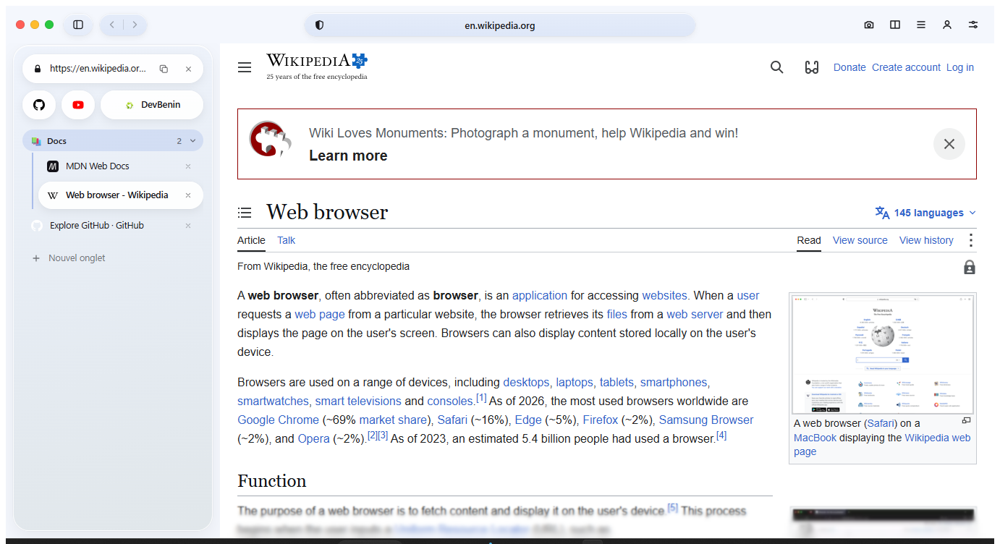
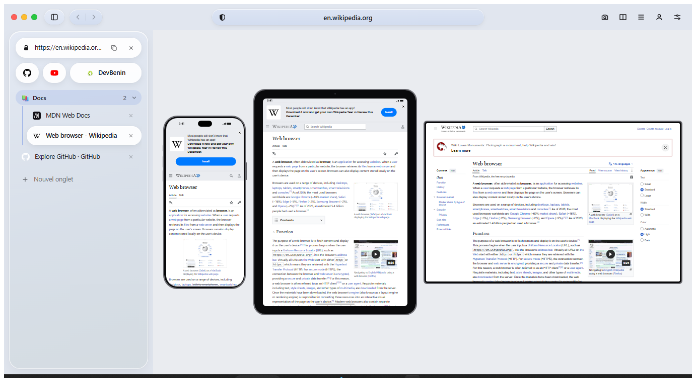

# Navigateur

A light, developer-minded web browser for Windows, with a calm interface that takes the colours of the page you are on.

*[Version française](README.fr.md)*



> **Working name.** "Navigateur" is the project's working title; the final name is still to be chosen.
> This is a personal project, shared as is. Version 0.1.0 is an early release.

## What it does

**Everyday browsing**
- Tabs in a side card you can resize or tuck away: pinned tabs, named and coloured groups, drag to reorder, session restored at startup.
- Shortcuts that open their site in place, split view (two pages side by side), bookmarks and history.
- An interface that follows the page: its background and accent colour tint the browser, softly. Light, dark, system or page-driven theme.
- French and English, following the Windows language.
- Profiles with separate data, and private windows erased when closed.

**Calm by default**
- Ads and trackers blocked out of the box with [uBlock Origin Lite](https://github.com/uBlockOrigin/uBOL-home), built in and kept up to date.
- A floating player: leave a tab where a video plays and it stays on screen, with the browser's own controls.
- Site permissions asked once, remembered per site, and easy to forget.

**Light**
- Inactive tabs are suspended after 5 minutes and unloaded after 30; reopened tabs load only when you show them.
- One renderer process per site.

**For developers**
- Device simulator with real device shells, rotation, and a side-by-side comparison of several screens.
- Network inspector: requests, API filter, errors, headers and response bodies.
- Localhost comfort: `:3000` opens `http://localhost:3000`, a dev server that is not up yet is retried automatically.
- Screenshots of an area, the visible part or the full page, as PNG or PDF.



## Download

Get the latest archive from the [Releases](../../releases/latest) page:

| Your Windows | File |
|---|---|
| 64-bit Intel or AMD (most PCs) | `Navigateur-<version>-win-x64.zip` |
| ARM (Snapdragon PCs, Surface Pro X…) | `Navigateur-<version>-win-arm64.zip` |
| 32-bit | `Navigateur-<version>-win-x86.zip` |

Unzip it anywhere and run `Navigateur.exe`. There is no installer yet, and nothing else to install: the only
requirement is the Microsoft Edge **WebView2 Runtime**, which ships with Windows 11 and most Windows 10 machines
([download](https://developer.microsoft.com/microsoft-edge/webview2/) if it is missing). Windows 10 version 1809 or later.

### "Windows protected your PC"

The archives are **not code-signed**: a signing certificate costs money this project does not have. Windows
SmartScreen will therefore warn you the first time; choose *More info* → *Run anyway*.

You do not have to take that on trust. Each release can be checked two ways:

```powershell
# 1. The checksum matches the one published with the release (SHA256SUMS.txt)
Get-FileHash .\Navigateur-0.1.0-win-x64.zip -Algorithm SHA256

# 2. The archive was built by this repository's release workflow (GitHub CLI)
gh attestation verify .\Navigateur-0.1.0-win-x64.zip --repo OWNER/REPO
```

## Privacy

- No telemetry, no account.
- What leaves your computer on the browser's own initiative: search suggestions sent to your search engine as you
  type in the address bar (can be turned off), a weekly check for a newer uBlock Origin Lite on GitHub, and the
  site icons of your shortcuts.
- Web pages have no channel to the browser's own code.

## Keyboard shortcuts

| | |
|---|---|
| `Ctrl+T` / `Ctrl+W` | New tab / close tab |
| `Ctrl+Shift+T` | Reopen the last closed tab |
| `Ctrl+Shift+N` | New private window |
| `Ctrl+L` | Address bar |
| `Ctrl+Tab` / `Ctrl+Shift+Tab` | Next / previous tab |
| `Alt+←` / `Alt+→` | Back / forward |
| `Ctrl +` / `Ctrl -` / `Ctrl 0` | Zoom |

## Build from source

You need Windows, the [.NET 10 SDK](https://dotnet.microsoft.com/download) and [Node.js](https://nodejs.org).

```powershell
cd ui
npm ci
npm run build          # the interface (React), copied next to the executable by the build
cd ..
pwsh tools/get-ublock.ps1                      # fetches uBlock Origin Lite (optional: without it nothing is blocked)
dotnet test tests/Browser.Core.Tests
dotnet run --project src/Browser.App
```

Release archives for the three architectures: `pwsh tools/publish.ps1 -Arch x64,arm64,x86`.

`tools/env.ps1` is the author's own setup (everything on drive `D:`); you do not need it.

## How it is made

- **Engine**: Microsoft Edge WebView2 (Chromium), one view per tab.
- **Host**: C# / .NET 10 with WinUI 3 (`src/Browser.App`). It owns all state.
- **Logic**: plain, tested C# with no UI dependency (`src/Browser.Core`, tests in `tests/`).
- **Interface**: React and TypeScript (`ui/`), loaded from local files under a strict content security policy. It sends
  validated commands to the host and receives the state back.

## Publishing a release (maintainers)

1. Set `<Version>` in `src/Browser.App/Browser.App.csproj`.
2. Tag and push: `git tag v0.1.0 && git push origin v0.1.0`.
3. The *Release* workflow builds the three archives, publishes their checksums and provenance attestations, and creates the GitHub release.

## Licence

[MIT](LICENSE). Third-party software shipped with the browser, uBlock Origin Lite (GPLv3) in particular, is listed in
[THIRD-PARTY-NOTICES.md](THIRD-PARTY-NOTICES.md).
