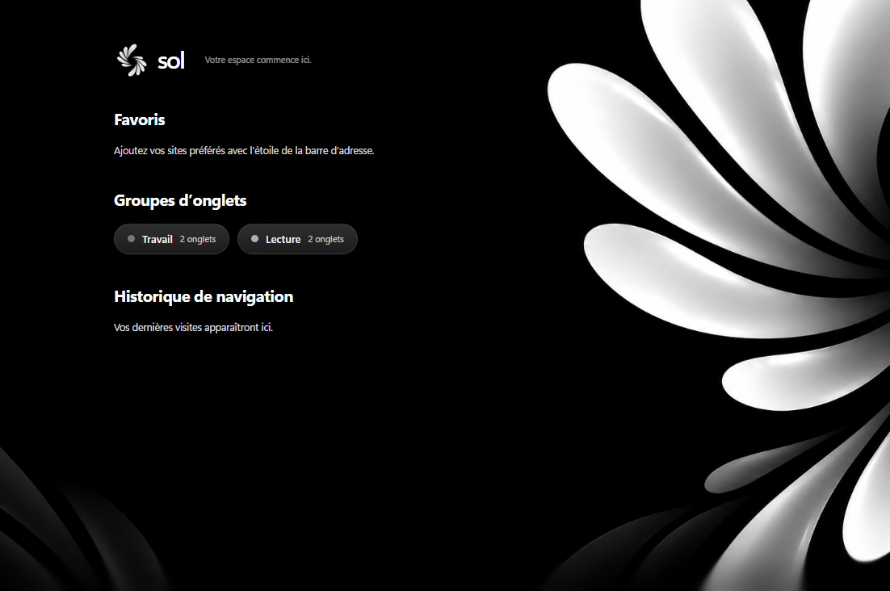
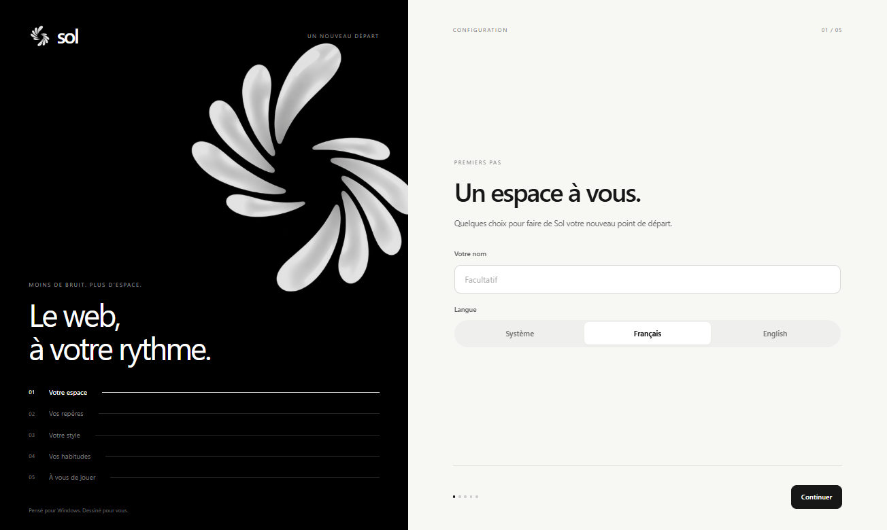
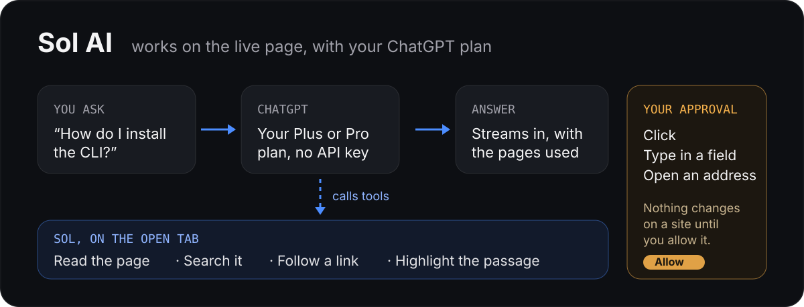

<p align="center"></p>

# Sol

**Sol browser** is a light web browser for Windows, with tabs in a sidebar, Chrome Web Store extensions and tools for web developers. Its interface takes the colours of the page you are looking at.

*[Version française](README.fr.md)*





> A personal project, shared as is. Expect rough edges.

## What it does

**Everyday browsing**
- Tabs in a side card you can resize or hide. Drag a tab to reorder it, or onto a group to add it; drag it out to remove it.
- Pinned tabs stay in place when you close them: the page is unloaded and comes back when you click it.
- Named, coloured tab groups, split view (two pages side by side), bookmarks and history.
- Shortcuts that open their site in place.
- The session is restored at startup.
- Sol opens in full screen with its whole interface; the green button switches to a window. A video in full screen takes the entire screen.
- French and English, following the Windows language.
- Profiles with separate data, and private windows erased when closed.

**Your data**
- First-run setup: your name, language, theme, font and search engine.
- Import from Chrome, Edge, Brave, Comet, Arc, Vivaldi and Opera: bookmarks, history and saved passwords. Passwords a browser keeps to itself can be imported from the CSV file it exports.
- Backup: settings, tabs, bookmarks, history and passwords in one file, encrypted with a key you choose. Sol does not keep the key.

**Appearance**
- Light, dark, Windows or page-driven theme.
- The interface colour follows the page, including the video that is playing or the part of the page on screen. Each zone can be turned off.
- Interface fonts: system, Inter, Segoe UI, Geist, Manrope, DM Sans, Plus Jakarta Sans, Outfit, Figtree, Nunito or Lora.
- New tab background: Sol's image, an Unsplash photo of your choice, or a new one every day.

**Fewer distractions**
- Floating player: leave a tab where a video plays and it stays on screen in the engine's video window (Picture-in-Picture).
- Sites ask once for the microphone, camera or location; the answer is remembered per site and can be forgotten.

**Light on memory**
- Inactive tabs request sleep after 30 seconds on PCs with up to 4 GB RAM, 1 minute up to 8 GB, and 5 minutes above that. If the engine needs scripts to keep running, they use reduced-memory mode. Safe pages unload after 10, 15 or 30 minutes respectively; drafts, media and private tabs keep their live document. Restored tabs load only when you show them.
- One renderer process per site.

**For developers**
- Device simulator with real device shapes, rotation, and several screens side by side.
- Network inspector: requests, API filter, errors, headers and response bodies.
- `:3000` opens `http://localhost:3000`, and a dev server that is not up yet is retried automatically.
- Screenshots of an area, the visible part or the full page, as PNG or PDF, with a preview before saving. A simulated device is captured with its frame.


## Sol AI

An optional assistant that runs on **your own ChatGPT Plus or Pro plan** through *Sign in with ChatGPT*: no API key, no extra bill. Connect it in *Settings → Sol*.

<p align="center"></p>

- **Ask the site, not a snippet.** Sol AI reads the open tab as structure (headings, text, links, buttons, fields), searches it, follows links to other pages of a documentation and highlights the passage it used. Each step is shown as it happens.
- **Your approval before acting.** Allow each action, or choose *Always allow* in the chat or Sol AI settings. Standing permission applies across sites in this profile, survives restart and can be revoked in settings. Password, card and one-time-code fields are never read or filled.
- **One-click actions.** *Summarize* in the address bar; right-click a selection to explain or translate it (six languages), or a text field to fix, rephrase or translate it, then replace the text.
- **Chat panel** on the right for quick questions, able to look at the open tab.
- **Browser agent:** inspect form constraints and errors, fill fields, use the keyboard, extract tables and real links, wait for page results, find, duplicate and pin tabs, and prepare a workspace with a note. The agent verifies results and refreshes stale references before retrying.
- **Voice temporarily hidden:** Windows transcription was insufficient in real use. The official beUI Voice Orb is preserved for a future voice engine; no microphone is started by Sol AI.
- **Web development help:** explain console or network errors with ChatGPT, suggest code fixes, control capture and HTTP mocks, open DevTools and test responsive layouts. Diagnostics are sent only for requested analysis, with known secrets masked.
- **Notes:** search, summarize, or create a note from an instruction.
- **Topics on the start page:** bookmarks and history sorted into categories once a day. Off by default; only titles and domains are sent.

Only what you act on goes to OpenAI. Sign-in tokens stay encrypted on your PC, and Sol AI does not run in private windows.

## Download

Get the latest version from the [Releases](https://gitlab.com/stevencrdkoulo/sol-browser/-/releases) page.

| Your Windows | Installer | Portable archive |
|---|---|---|
| 64-bit Intel or AMD (most PCs) | `Sol-<version>-win-x64-Setup.exe` | `Sol-<version>-win-x64.zip` |
| ARM (Snapdragon PCs) | `Sol-<version>-win-arm64-Setup.exe` | `Sol-<version>-win-arm64.zip` |
| 32-bit | `Sol-<version>-win-x86-Setup.exe` | `Sol-<version>-win-x86.zip` |

**The installer** sets Sol up for your user account, without administrator rights, and adds the shortcuts. An installed Sol:
- updates itself: a new version downloads in the background, then a card at the bottom right offers to restart;
- is listed by Windows as a browser, in *Open with* for web pages and PDF files and in *Settings → Apps → Default apps*.

**The archive** needs no installation: unzip it anywhere and run `Sol.exe`. It does not update itself.

Requirements: Windows 10 version 1809 or later, and the Microsoft Edge **WebView2 Runtime**, which ships with Windows 11 and most Windows 10 machines ([download](https://developer.microsoft.com/microsoft-edge/webview2/) if it is missing).

### "Windows protected your PC"

The files are **not code-signed**: a signing certificate costs money this project does not have. Windows SmartScreen warns the first time; choose *More info* → *Run anyway*.

You can check a download against the checksum published with each release (`SHA256SUMS.txt`):

```powershell
Get-FileHash .\Sol-1.0.12-win-x64-Setup.exe -Algorithm SHA256
```

## Privacy

- No account or telemetry sent to Sol's author. Sol AI is optional: it uses your own ChatGPT subscription through Sign in with ChatGPT. Your questions, selected text and context consulted at your request are sent to OpenAI. Bookmark and history sorting stays off by default.
- Bookmarks, history, passwords and settings stay on your computer. A backup leaves it only as the encrypted file you export.
- Connections Sol makes on its own:
  - search suggestions, sent to your search engine as you type in the address bar (can be turned off);
  - a check for a newer Sol on GitLab at startup (installed copies only);
  - the site icons of your shortcuts;
  - the new tab background photo, if you choose one: it is downloaded from `picsum.photos` (Unsplash photos), along with the thumbnails when you open the selection.
- Web pages have no channel to the browser's own code.

## Keyboard shortcuts

| | |
|---|---|
| `Ctrl+T` / `Ctrl+W` | New tab / close tab |
| `Ctrl+Shift+T` | Reopen the last closed tab |
| `Ctrl+Shift+N` | New private window |
| `Ctrl+L` | Address bar |
| `Ctrl+Tab` / `Ctrl+Shift+Tab` | Next / previous tab |
| `Alt+←` / `Alt+→` | Back / forward |
| `Ctrl +` / `Ctrl -` / `Ctrl 0` | Zoom in / out / reset |
| `F5` | Reload |

## Build from source

You need Windows, the [.NET 10 SDK](https://dotnet.microsoft.com/download) and [Node.js](https://nodejs.org) (current LTS).

```powershell
cd ui
npm ci
npm run build          # the interface (React), copied next to the executable by the build
cd ..
dotnet test tests/Browser.Core.Tests
dotnet run --project src/Browser.App
```

Release files for the three architectures: `pwsh tools/publish.ps1 -Arch x64,arm64,x86`. The installers are built too when the Velopack tool is present (`dotnet tool install -g vpk`).

`tools/env.ps1` is the author's own setup (everything on drive `D:`); you do not need it.

## How it is made

- **Engine**: Microsoft Edge WebView2 (Chromium), one view per tab.
- **Host**: C# / .NET 10 with WinUI 3 (`src/Browser.App`). It owns all state.
- **Logic**: plain, tested C# with no UI dependency (`src/Browser.Core`, tests in `tests/`).
- **Interface**: React and TypeScript (`ui/`), loaded from local files under a strict content security policy. It sends validated commands to the host and receives the state back.
- **Sol AI**: the ChatGPT Responses API with *Sign in with ChatGPT* (OAuth with PKCE, tokens protected by Windows). Page tools run in the tab from `src/Browser.App/inject/agent.js`; the interface uses [beUI](https://beui.dev) agent components.
- **Installer and updates**: [Velopack](https://velopack.io), reading the releases of this repository.

## Publishing a release (maintainers)

1. Set `<Version>` in `src/Browser.App/Browser.App.csproj`.
2. Tag and push: `git tag v1.0.12 && git push origin v1.0.12`.
3. The `release` pipeline job builds the installers and archives for the three architectures, publishes their checksums, and creates the GitLab release. Installed copies pick it up from there.

## Code signing policy

Releases are not signed yet. An application to the [SignPath Foundation](https://signpath.org), which signs open-source projects for free, is planned; until it is accepted, use the checksums described above.

- Committer, reviewer and approver: [Steven KOULO](https://gitlab.com/stevencrdkoulo).
- Every released file is built by the [release pipeline](.gitlab-ci.yml) from a tagged commit of this repository; nothing is built or uploaded by hand.
- Privacy: Sol sends no information to its author. See [Privacy](#privacy) for the only connections it makes on its own.

## Licence

[MIT](LICENSE). Third-party software shipped with Sol is listed in [THIRD-PARTY-NOTICES.md](THIRD-PARTY-NOTICES.md).
