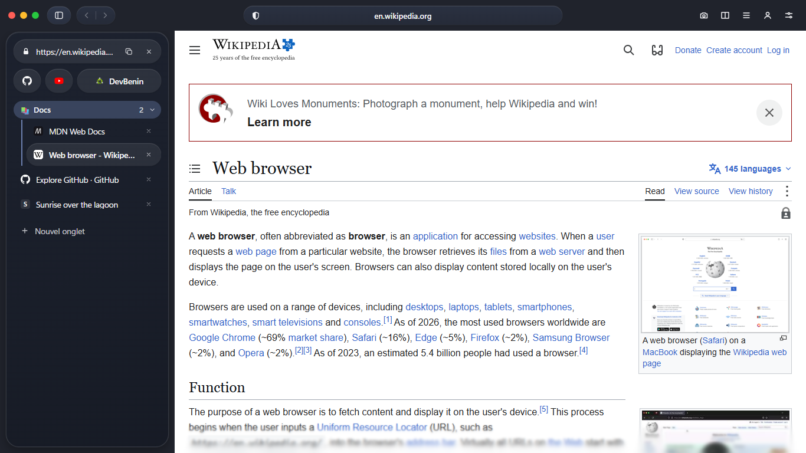

<p align="center"></p>

# Sol

**Sol browser** is a light web browser for Windows, with tabs in a sidebar, built-in ad blocking and tools for web developers. Its interface takes the colours of the page you are looking at.

*[Version française](README.fr.md)*




> A personal project, shared as is. The 0.1 versions are early releases: expect rough edges.

## What it does

**Everyday browsing**
- Tabs in a side card you can resize or hide. Drag a tab to reorder it, or onto a group to add it; drag it out to remove it.
- Pinned tabs stay in place when you close them: the page is unloaded and comes back when you click it.
- Named, coloured tab groups, split view (two pages side by side), bookmarks and history.
- Shortcuts that open their site in place.
- The session is restored at startup.
- Sol opens in full screen with its whole interface; the green button switches to a window. A video in full screen takes the entire screen.
- French and English, following the Windows language.
- Profiles with separate data, and private windows erased when closed.

**Your data**
- First-run setup: your name, language, theme, font, search engine, and what to block.
- Import from Chrome, Edge, Brave, Comet, Arc, Vivaldi and Opera: bookmarks, history and saved passwords. Passwords a browser keeps to itself can be imported from the CSV file it exports.
- Backup: settings, tabs, bookmarks, history and passwords in one file, encrypted with a key you choose. Sol does not keep the key.

**Appearance**
- Light, dark, Windows or page-driven theme.
- The interface colour follows the page, including the video that is playing or the part of the page on screen. Each zone can be turned off.
- Interface fonts: system, Inter or SF Pro.

**Fewer distractions**
- Ads and trackers blocked with [uBlock Origin Lite](https://github.com/uBlockOrigin/uBOL-home), built in and kept up to date.
- Floating player: leave a tab where a video plays and it stays on screen, with Sol's own controls.
- Sites ask once for the microphone, camera or location; the answer is remembered per site and can be forgotten.

**Light on memory**
- Inactive tabs are suspended after 5 minutes and unloaded after 30. Restored tabs load only when you show them.
- One renderer process per site.

**For developers**
- Device simulator with real device shapes, rotation, and several screens side by side.
- Network inspector: requests, API filter, errors, headers and response bodies.
- `:3000` opens `http://localhost:3000`, and a dev server that is not up yet is retried automatically.
- Screenshots of an area, the visible part or the full page, as PNG or PDF.


## Download

Get the latest version from the [Releases](https://gitlab.com/stevencrdkoulo/sol-browser/-/releases) page.

| Your Windows | Installer | Portable archive |
|---|---|---|
| 64-bit Intel or AMD (most PCs) | `Sol-<version>-win-x64-Setup.exe` | `Sol-<version>-win-x64.zip` |
| ARM (Snapdragon PCs) | `Sol-<version>-win-arm64-Setup.exe` | `Sol-<version>-win-arm64.zip` |
| 32-bit | `Sol-<version>-win-x86-Setup.exe` | `Sol-<version>-win-x86.zip` |

**The installer** sets Sol up for your user account, without administrator rights, and adds the shortcuts. An installed Sol:
- updates itself: a new version downloads in the background, then a card at the bottom right offers to restart;
- is listed by Windows as a browser, in *Open with* for web pages and PDF files and in *Settings → Apps → Default apps*.

**The archive** needs no installation: unzip it anywhere and run `Sol.exe`. It does not update itself.

Requirements: Windows 10 version 1809 or later, and the Microsoft Edge **WebView2 Runtime**, which ships with Windows 11 and most Windows 10 machines ([download](https://developer.microsoft.com/microsoft-edge/webview2/) if it is missing).

### "Windows protected your PC"

The files are **not code-signed**: a signing certificate costs money this project does not have. Windows SmartScreen warns the first time; choose *More info* → *Run anyway*.

You can check a download against the checksum published with each release (`SHA256SUMS.txt`):

```powershell
Get-FileHash .\Sol-0.1.4-win-x64-Setup.exe -Algorithm SHA256
```

## Privacy

- No account or telemetry sent to Sol's author. Optional Sol AI uses Microsoft's local runtime with optional telemetry disabled; its catalog/downloads contact Microsoft and the runtime may collect essential diagnostics. Model inference runs locally.
- Bookmarks, history, passwords and settings stay on your computer. A backup leaves it only as the encrypted file you export.
- Connections Sol makes on its own:
  - search suggestions, sent to your search engine as you type in the address bar (can be turned off);
  - a check for a newer Sol on GitLab at startup (installed copies only);
  - a weekly check for a newer uBlock Origin Lite on GitHub;
  - the site icons of your shortcuts.
- Web pages have no channel to the browser's own code.

## Keyboard shortcuts

| | |
|---|---|
| `Ctrl+T` / `Ctrl+W` | New tab / close tab |
| `Ctrl+Shift+T` | Reopen the last closed tab |
| `Ctrl+Shift+N` | New private window |
| `Ctrl+L` | Address bar |
| `Ctrl+Tab` / `Ctrl+Shift+Tab` | Next / previous tab |
| `Alt+←` / `Alt+→` | Back / forward |
| `Ctrl +` / `Ctrl -` / `Ctrl 0` | Zoom in / out / reset |
| `F5` | Reload |

## Build from source

You need Windows, the [.NET 10 SDK](https://dotnet.microsoft.com/download) and [Node.js](https://nodejs.org) (current LTS).

```powershell
cd ui
npm ci
npm run build          # the interface (React), copied next to the executable by the build
cd ..
pwsh tools/get-ublock.ps1                      # fetches uBlock Origin Lite (optional: without it nothing is blocked)
dotnet test tests/Browser.Core.Tests
dotnet run --project src/Browser.App
```

Release files for the three architectures: `pwsh tools/publish.ps1 -Arch x64,arm64,x86`. The installers are built too when the Velopack tool is present (`dotnet tool install -g vpk`).

`tools/env.ps1` is the author's own setup (everything on drive `D:`); you do not need it.

## How it is made

- **Engine**: Microsoft Edge WebView2 (Chromium), one view per tab.
- **Host**: C# / .NET 10 with WinUI 3 (`src/Browser.App`). It owns all state.
- **Logic**: plain, tested C# with no UI dependency (`src/Browser.Core`, tests in `tests/`).
- **Interface**: React and TypeScript (`ui/`), loaded from local files under a strict content security policy. It sends validated commands to the host and receives the state back.
- **Installer and updates**: [Velopack](https://velopack.io), reading the releases of this repository.

## Publishing a release (maintainers)

1. Set `<Version>` in `src/Browser.App/Browser.App.csproj`.
2. Tag and push: `git tag v0.1.4 && git push origin v0.1.4`.
3. The `release` pipeline job builds the installers and archives for the three architectures, publishes their checksums, and creates the GitLab release. Installed copies pick it up from there.

## Code signing policy

Releases are not signed yet. An application to the [SignPath Foundation](https://signpath.org), which signs open-source projects for free, is planned; until it is accepted, use the checksums described above.

- Committer, reviewer and approver: [Steven KOULO](https://gitlab.com/stevencrdkoulo).
- Every released file is built by the [release pipeline](.gitlab-ci.yml) from a tagged commit of this repository; nothing is built or uploaded by hand.
- Privacy: Sol sends no information to its author. See [Privacy](#privacy) for the only connections it makes on its own.

## Licence

[MIT](LICENSE). Third-party software shipped with the browser, uBlock Origin Lite (GPLv3) in particular, is listed in [THIRD-PARTY-NOTICES.md](THIRD-PARTY-NOTICES.md).
